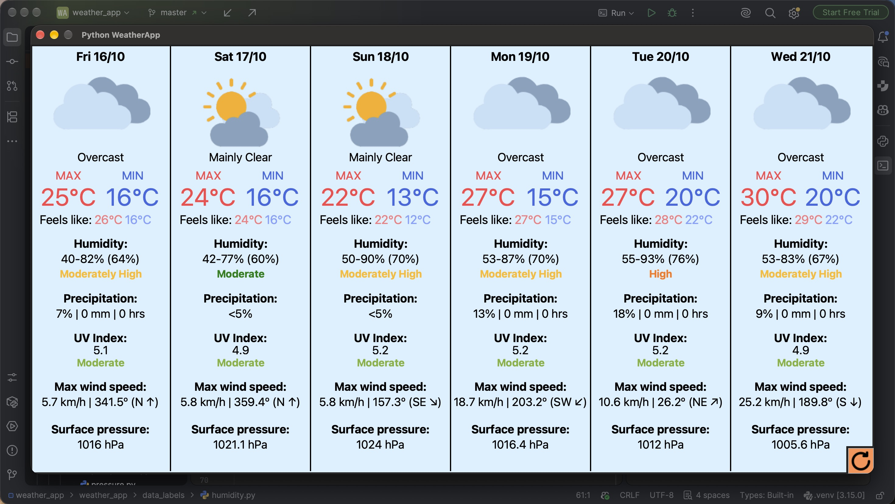

# Weather App



A desktop weather app with a Tkinter GUI that fetches forecasts from Open-Meteo
and displays daily conditions, temperatures, humidity, and more.

- The app uses IP-based geolocation for coordinates.
- The Open-Meteo client caches responses locally (you may see a `.cache.sqlite`
  file created).


## Requirements

- Python 3.12 or above recommended
- Internet connection

## Setup

```bash
cd <path/to/directory/weather_app>
python -m pip install -r requirements.txt
```

## Run

```bash
cd <path/to/directory/weather_app>
python -m weather_app
```

---

This was initially made when I had low code design skills. The architecture 
is genuinely so bad. I'm so sorry.
